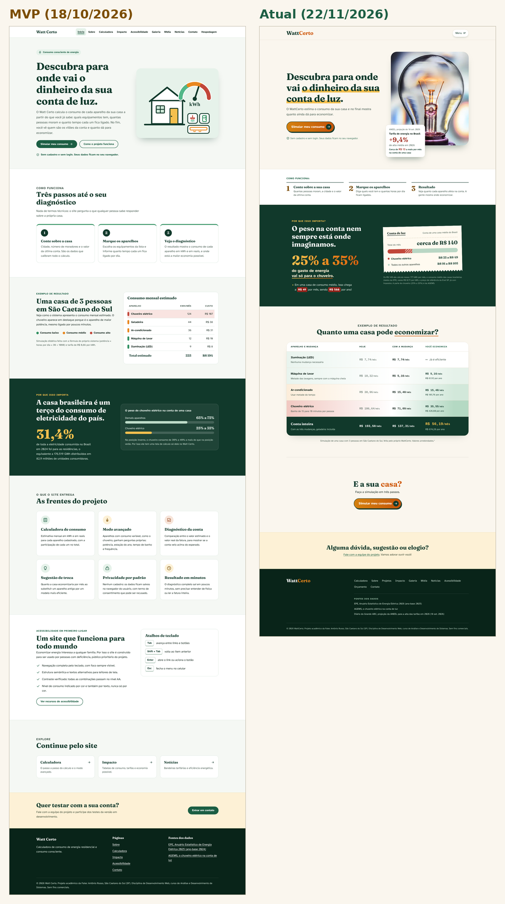
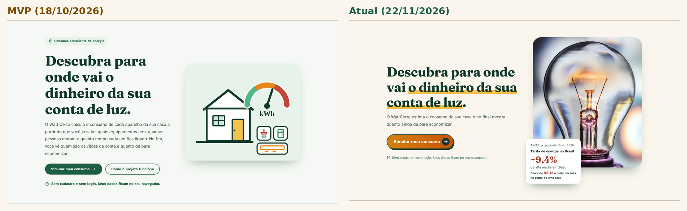
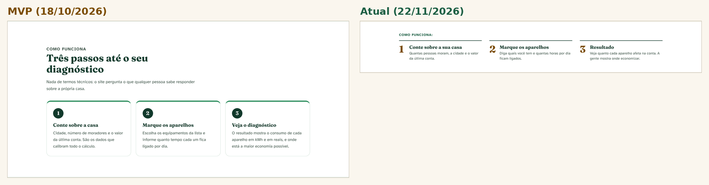
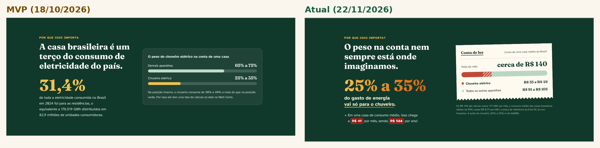
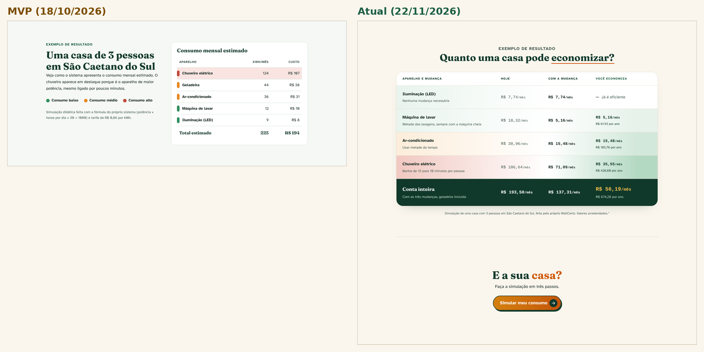
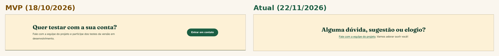
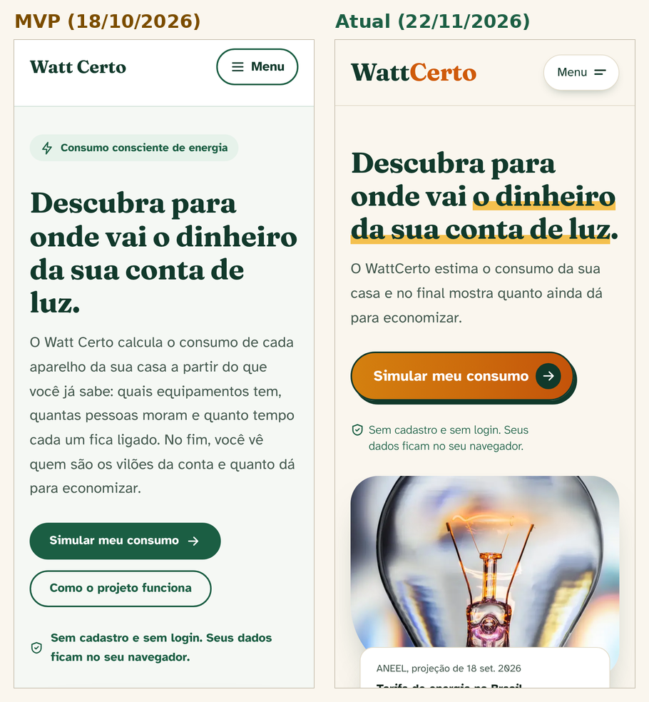

# Relatório de melhorias: do MVP ao site final

Não houve apontamentos do professor na apresentação do MVP (A05). As melhorias abaixo foram identificadas pela própria equipe ao revisar o site. Os prints comparam o MVP (commit `d204f8a`, 18/10/2026) com a versão final (22/11/2026), na mesma tela de computador (1440 px). Todos ficam em [`evidencias/antes-depois/`](evidencias/antes-depois/).

## Home (página principal)

A Home foi a página que mais mudou. Ela ficou mais curta e mais direta: de 9 blocos para 5, e de 5.286 px para 3.714 px de altura no computador. O que saiu dela não foi apagado; foi para a página certa.

| Parte | MVP | Agora | Por quê |
|---|---|---|---|
| **Topo** | Ilustração de casa e medidor; texto de 5 linhas; dois botões | Foto real; título com grifo amarelo em "o dinheiro da sua conta de luz"; texto de 2 linhas; um botão só ("Simular meu consumo"); cartão com a alta da tarifa prevista pela ANEEL (+9,4%) | Um caminho principal, sem dúvida sobre onde clicar, e um dado concreto logo de cara |
| **Menu (computador)** | 10 links na barra, apertados | Botão "Menu" que abre a lista das 11 páginas | Cabe em qualquer tela, inclusive com letra grande |
| **Como funciona** | Três cartões grandes com parágrafo | Uma faixa só, com os 3 passos numerados | O mesmo recado em um terço do espaço |
| **Por que isso importa** | "31,4% da eletricidade do país vai para as casas" | "25% a 35% do gasto de energia vai só para o chuveiro", com o valor em reais (R$ 49 por mês, R$ 588 por ano) e uma conta de luz desenhada | A família entende reais na conta, não GWh do país. O dado do Brasil foi para a página Impacto |
| **Exemplo** | Tabela de consumo por aparelho | Tabela de economia: hoje, com a mudança e quanto se economiza. São R$ 56,19 por mês na conta inteira, e no fim vem "E a sua casa?" | Mostra o resultado que importa (quanto se economiza), não só o gasto |
| **Frentes, acessibilidade e "Continue pelo site"** | Três blocos na Home | Foram para a Sobre, a Acessibilidade e o fim das páginas internas | Home menor; cada assunto na sua página |
| **Chamada final** | "Quer testar com a sua conta?" e botão | "Alguma dúvida, sugestão ou elogio?" com link para o Contato | Convite mais aberto, sem prometer teste que não existe |
| **Celular** | Texto de 6 linhas e dois botões empilhados antes de qualquer imagem | Texto de 3 linhas, um botão grande e a foto logo abaixo | Menos leitura antes da ação principal |

## Outras páginas

| Página | MVP | Agora | Print |
|---|---|---|---|
| Sobre, Projetos, Impacto, Acessibilidade, Galeria, Mídia, Notícias e Orçamento | Aviso "Página em construção" (só a Calculadora tinha conteúdo) | Todas completas, com conteúdo e fontes; a Projetos é nova | [sobre](evidencias/antes-depois/sobre.png), [impacto](evidencias/antes-depois/impacto.png), [acessibilidade](evidencias/antes-depois/acessibilidade.png), [galeria](evidencias/antes-depois/galeria.png), [mídia](evidencias/antes-depois/midia.png), [notícias](evidencias/antes-depois/noticias.png), [orçamento](evidencias/antes-depois/orcamento_hospedagem.png) |
| Calculadora | Já funcionava (era a única página interna com conteúdo) | Mesmo cálculo, agora com o catálogo de aparelhos vindo do banco de dados (JSON) e no padrão visual das outras páginas | [calculadora](evidencias/antes-depois/calculadora.png) |
| Contato | Formulário sem envio ("o envio será ativado quando o site for publicado") | Envio pelo Netlify Forms, equipe na página e dados de contato fictícios | [contato](evidencias/antes-depois/contato.png) |
| Todas | Visual igual em tudo, com cada seção num formato | Um padrão só: abertura centralizada, títulos à esquerda e conteúdo à direita, fundos alternados | (todas acima) |

## Qualidade técnica

| Item | MVP | Agora |
|---|---|---|
| Validação W3C | Sem verificação registrada nas 10 páginas | 0 erros nas 11 páginas ([evidências](evidencias-de-testes.md)) |
| Acessibilidade automática (axe) | Não testada | 0 problemas nas 11 páginas |
| Contraste | Laranja dos títulos pequenos com 4,2:1 (abaixo do AA) | 4,9:1; as 14 combinações passam no AA |
| Imagens | Uma ilustração SVG na Home | Fotos e telas em WebP, em até 3 tamanhos, com carregamento sob demanda |
| Fontes dos dados | EPE 2025 (ano-base 2024) | EPE 2026 (ano-base 2025), ANEEL, AGEMS, Procel e Lei 15.235/2025 |
| Segurança | Sem cabeçalhos | Content-Security-Policy e outros cabeçalhos no `_headers` (Netlify) |
